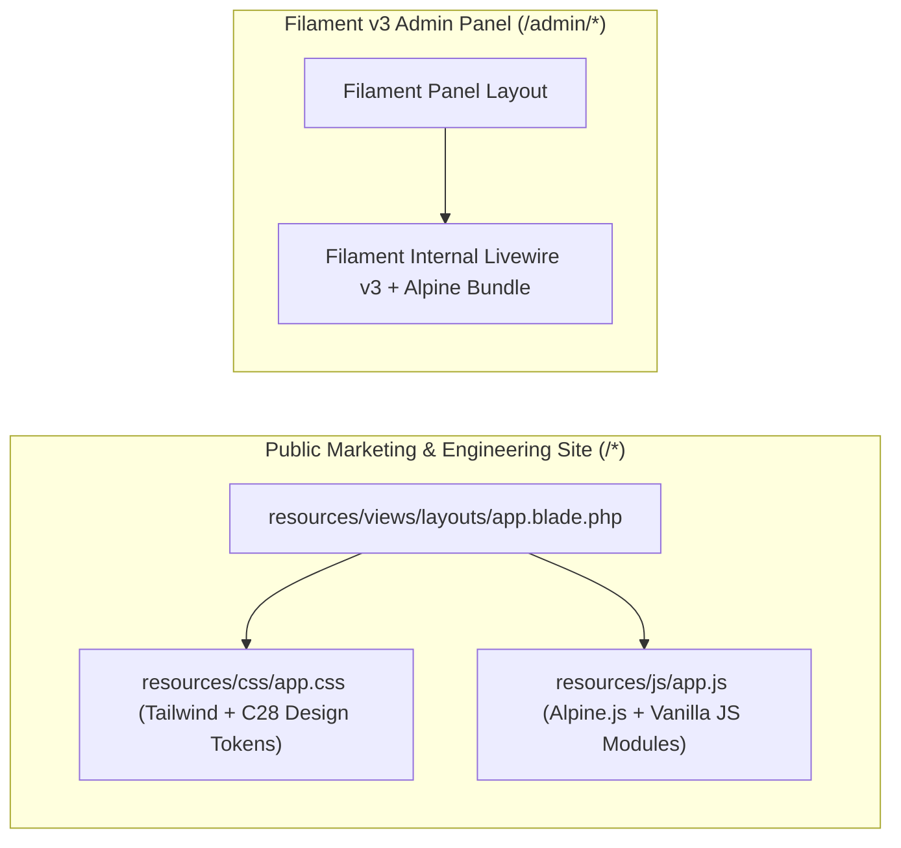

# Phase 01 (Foundation, Stack Setup & Project Constitution) — Design Review

**Status:** Design review only — no implementation authorized.

---

## 1. Objective

Establish the foundational Laravel 11 + MySQL + FilamentPHP v3 + Vite (Tailwind CSS, Alpine.js, Vanilla JS) application skeleton and authoritative project constitution (`AGENTS.md`) for **C28 — Software & Cloud Engineering** ("We build digital products and help teams deploy, secure, and operate them reliably.").

### User-Visible & Engineering Outcomes
1. **Project Constitution (`AGENTS.md`)**: Authoritative repository-level instructions codifying C28's positioning, 4-tier service hierarchy (1. DevOps & Cloud Engineering [Primary], 2. DevSecOps [Secondary], 3. Software Development [Supporting], 4. Website Development [Supporting]), 5 content categories (strictly distinguishing production client work from personal lab projects), locked tech stack, bespoke dark/emerald engineering design system (`#050806`, `#0A100D`, `#10B981`, `#00E676`), security rules, and phase orchestration gates.
2. **Laravel + MySQL Foundation**: A clean Laravel application initialized in the repository root without overwriting existing workspace artifacts (`.git/`, `.agent/`, `c28_landing_page.html`, `docs/`, `README.md`), with `.env.example` configured for MySQL (`DB_CONNECTION=mysql`, `DB_PORT=3306`, `DB_DATABASE=c28studios`).
3. **FilamentPHP v3 `/admin` Control Plane**: Filament Panel (`filament/filament:^3.2`) registered at `/admin` via `App\Providers\Filament\AdminPanelProvider`, secured by `FilamentUser` contract (`canAccessPanel(Panel $panel): bool`) on `App\Models\User` with role/flag authorization (`is_admin`), brand colors aligned to the C28 emerald palette, and architectural preparation for Filament Builder / NioBuilder dynamic block schemas in subsequent phases.
4. **Isolated Public Frontend Asset Pipeline**: Vite configured with Tailwind CSS, Alpine.js, and Vanilla JS (`resources/css/app.css`, `resources/js/app.js`) dedicated to public Blade layouts (`resources/views/layouts/app.blade.php`), completely isolated from Filament's internal Livewire v3 + Alpine runtime on `/admin/*` to prevent double-Alpine initialization conflicts.
5. **Base Smoke & Access Tests**: Automated Feature tests verifying public route response (`GET /`), `/admin/login` availability, and `FilamentUser` access control enforcement (unauthenticated redirect, non-admin `403 Forbidden`, admin `200 OK`).

---

## 2. Existing-State Audit (File Paths and Symbols)

### 2.1 Repository & Git State
- **Repository Root**: `c:\Users\User\Desktop\c28studios`
- **Remote**: `origin` -> `https://github.com/iam-borisjacobs/c28studios.git`
- **Current Branch**: `main` (at commit `50997da` — `Initial commit`)
- **Tracked Files**:
  - `README.md` (1 line: `# c28studios`)
- **Untracked Files (Must Be Preserved)**:
  - `.agent/skills/engineering-phase-orchestrator/SKILL.md` — Phase workflow skill definition (Stages 0, A, B, C, D, E).
  - `.agent/skills/engineering-phase-orchestrator/README.md` — Skill overview.
  - `.agent/skills/engineering-phase-orchestrator/references/phase-checklist.md` — Stage checklist reference.
  - `.agent/skills/engineering-phase-orchestrator/templates/design-review.md` — Stage A template.
  - `.agent/skills/engineering-phase-orchestrator/templates/implementation-report.md` — Stage D implementation template.
  - `.agent/skills/engineering-phase-orchestrator/templates/acceptance-report.md` — Stage D acceptance template.
  - `c28_landing_page.html` (1,924 lines, 138,698 bytes) — Reference static prototype containing C28's bespoke dark-mode visual language, typography (`Plus Jakarta Sans`, `JetBrains Mono`), color tokens (`obsidian-950: #040705`, body `#050806`, carbon surfaces, neon/emerald accents), and interactive Vanilla JS modules (`switchConsoleTab`, `triggerConsoleDeploy`, `setSnippet`, `cycleCodeSnippet`, `renderBlueprintNodes`, `setPricingMode`, `toggleFaq`, `openModal`, `openArticleModal`).

### 2.2 Local Environment & Toolchain Audit
- **OS**: Windows (PowerShell shell)
- **PHP**: `PHP 8.2.30 (cli)` at `C:\Users\User\.config\herd\bin\php82\php.exe` (Zend Engine v4.2.30, Zend OPcache v8.2.30).
  - **Verified PHP Extensions**: `bcmath`, `ctype`, `curl`, `dom`, `exif`, `fileinfo`, `filter`, `gd`, `iconv`, `intl`, `json`, `libxml`, `mbstring`, `mysqli`, `mysqlnd`, `openssl`, `pdo_mysql`, `pdo_sqlite`, `redis`, `session`, `sodium`, `sqlite3`, `tokenizer`, `xml`, `zip`, `zlib` (all required extensions for Laravel 11 and FilamentPHP v3 are present and active).
- **Composer**: `Composer version 2.9.2` running on PHP 8.2.30.
- **Node.js**: `v20.14.0`
- **NPM**: `10.9.2`
- **MySQL**:
  - Windows Service `MySQL80` is **Running** (`127.0.0.1:3306` TCP test succeeded).
  - Binary path: `"C:\Program Files\MySQL\MySQL Server 8.0\bin\mysql.exe"` (`Ver 8.0.45 for Win64 on x86_64 (MySQL Community Server - GPL)`).
  - Note: `mysql.exe` directory is not currently in the user `PATH` environment variable, though TCP port `3306` is listening and accessible to PHP `pdo_mysql`.

### 2.3 Application Code State
No Laravel application (`composer.json`, `artisan`, `app/`, `config/`, `database/`, `routes/`, `resources/`, `package.json`, `vite.config.js`) or `AGENTS.md` exists yet in the workspace.

---

## 3. Current Architecture and Conventions

1. **Workflow Governance**: Governed by `.agent/skills/engineering-phase-orchestrator/SKILL.md`. Every phase requires Stage 0 (Discovery), Stage A (Design Review + Hard Stop), Stage B (Approved Implementation), Stage C (Verification), Stage D (Documentation & Acceptance), and Stage E (Authorized Git Delivery).
2. **Visual & Frontend Reference (`c28_landing_page.html`)**:
   - **Color Palette**: Deep obsidian (`#050806`, `#040705`), carbon surfaces (`#0A100D`, `#070c09`, `#0b140e`, `#101f16`), glowing emerald/neon (`#10B981`, `#00E676`, `#22c55e`, `#4ade80`).
   - **Typography**: `Plus Jakarta Sans` for headings/UI prose; `JetBrains Mono` for terminal logs, config file headers, badges, and architectural metadata.
   - **UI Patterns**: Subtle 48px carbon grid (`bg-carbon-grid`), vertical emerald light pillar (`vertical-light-pillar`), glassmorphic cards (`glass-card`, `glass-card-highlight`), glowing emerald pill CTAs (`btn-emerald`), and interactive engineering artifacts (CI/CD terminal switcher, `Dockerfile`/`nginx.conf`/GitHub Actions snippet viewer, 10-step production blueprint inspector).

---

## 4. Proposed Design and Data Flow

### 4.1 Non-Destructive Laravel Initialization Strategy
Because `c:\Users\User\Desktop\c28studios` already contains `.git/`, `.agent/`, `README.md`, `c28_landing_page.html`, and `docs/`, `composer create-project` cannot be run directly against a non-empty root directory.
- **Scaffolding Procedure (Stage B)**:
  1. Run `composer create-project laravel/laravel:^11.0 _laravel_temp --no-interaction` into a temporary subdirectory.
  2. Move the Laravel skeleton files into the repository root while preserving `.git/`, `.agent/`, `c28_landing_page.html`, `docs/`, and merging/updating `README.md` and `.gitignore`.
  3. Remove `_laravel_temp`.
  4. Configure `.env.example` (and local `.env`) with C28 defaults:
     - `APP_NAME="C28 — Software & Cloud Engineering"`
     - `APP_URL=http://localhost:8000`
     - `DB_CONNECTION=mysql`
     - `DB_HOST=127.0.0.1`
     - `DB_PORT=3306`
     - `DB_DATABASE=c28studios`
     - `DB_USERNAME=root`
     - `DB_PASSWORD=`

### 4.2 FilamentPHP v3 `/admin` Panel & Access Control Architecture
- **Package**: `filament/filament:^3.2` installed via Composer and initialized with `php artisan filament:install --panels` (ID: `admin`, path: `/admin`).
- **Panel Configuration (`app/Providers/Filament/AdminPanelProvider.php`)**:
  - Path: `/admin`
  - Brand Name: `C28 Control Plane`
  - Primary Color: `Color::Emerald` (`#10B981`)
  - Dark Mode: Enabled by default (`->darkMode(true)`)
  - Middleware: Standard Laravel web/session/CSRF middleware + Filament `Authenticate` middleware.
- **`FilamentUser` Authorization (`app/Models/User.php`)**:
  - `User` implements `Filament\Models\Contracts\FilamentUser`.
  - Adds boolean `is_admin` column (default `false`, cast to `boolean`) via migration.
  - `canAccessPanel(Panel $panel): bool` enforces `$this->is_admin === true && $this->hasVerifiedEmail()` (or `$this->is_admin === true` with explicit boolean check so non-admin users receive `403 Forbidden` even in `local` environment).
- **Dynamic Content & Block Builder Readiness (Filament Builder / NioBuilder Pipeline)**:
  - Filament v3's native `Filament\Forms\Components\Builder` (`Builder\Block`) combined with custom JSON block-schema rendering components (and/or NioBuilder visual block patterns) will power dynamic page sections, case studies, service deliverables, pricing tiers, and lab notes in Phase 2+.
  - Phase 1 establishes the `app/Filament/Blocks/` namespace convention and base Blade component directory (`resources/views/components/blocks/`) so Phase 2 CMS resources plug cleanly into the builder pipeline.

### 4.3 Frontend Asset Pipeline & Script Isolation
To ensure Filament's internal Livewire v3 + Alpine.js bundle on `/admin/*` never collides with public page scripts:

- **Tailwind CSS Setup**:
  - Configure Tailwind (`tailwind.config.js` + `postcss.config.js` + `resources/css/app.css`) with custom C28 design tokens:
    - Fonts: `sans: ['"Plus Jakarta Sans"', 'sans-serif']`, `mono: ['"JetBrains Mono"', 'monospace']`
    - Colors:
      - `obsidian`: `950: '#040705'`, `900: '#050806'`, `850: '#070c09'`, `800: '#0A100D'`, `700: '#101f16'`
      - `emerald` / `neon`: `400: '#4ade80'`, `500: '#10B981'`, `accent: '#00E676'`, `600: '#16a34a'`
    - Custom utility classes in `resources/css/app.css`: `.bg-carbon-grid`, `.hero-beam`, `.vertical-light-pillar`, `.vertical-light-core`, `.glass-card`, `.glass-card-highlight`, `.btn-emerald`, `.section-badge`.
- **Alpine.js + Vanilla JS Setup (`resources/js/app.js`)**:
  - Install `alpinejs` via NPM.
  - Initialize `window.Alpine = Alpine; Alpine.start();` inside `resources/js/app.js` (loaded ONLY by public layouts via `@vite(['resources/css/app.css', 'resources/js/app.js'])`, never injected globally into Filament's panel unless registered as a dedicated Filament theme CSS).
- **Base Public Layout & Route (`resources/views/layouts/app.blade.php` & `resources/views/welcome.blade.php`)**:
  - Replace the stock Laravel welcome screen with a C28 foundation shell using the obsidian/emerald design tokens, confirming Vite asset compilation and rendering the C28 core statement.

### 4.4 Draft Project Constitution (`AGENTS.md` Plan)
In Stage B, `AGENTS.md` will be created at the repository root with the following authoritative structure and rules:

1. **Identity & Source of Truth**:
   - **Business Name**: C28 — Software & Cloud Engineering
   - **Core Statement**: *"We build digital products and help teams deploy, secure, and operate them reliably."*
   - **Positioning**: One connected engineering studio bridging software development, cloud/DevOps deployment, DevSecOps pipeline security, and ongoing infrastructure operations for startup founders, small SaaS teams, and growing businesses.
2. **Strict Service Hierarchy**:
   1. **Primary — DevOps & Cloud Engineering**: Application deployment, Linux server configuration, CI/CD pipelines (GitHub Actions), Docker containerization, cloud setup, Nginx/HTTPS, operational monitoring, and cloud cost control.
   2. **Secondary — DevSecOps**: Dependency vulnerability scanning, secret management & environment isolation, container image scanning (e.g., Trivy), and automated CI/CD security gates.
   3. **Supporting — Software Development**: SaaS applications, REST/GraphQL APIs, backend systems, business web apps, and custom internal dashboards designed for clean production deployment.
   4. **Supporting — Website Development**: High-conversion business websites, landing pages, e-commerce, redesigns, performance optimization, and technical SEO.
3. **Content Categories & Integrity Rule**:
   - Five supported categories:
     1. Practical DevOps demonstrations
     2. Developer conversations
     3. Website/software development
     4. DevSecOps/security
     5. Personal engineering journey
   - **Mandatory Distinction Rule**: Every project, case study, walkthrough, or lab note MUST explicitly distinguish between **Production Client Work** (`work_type = client_production`) and **Personal / Studio Lab Projects** (`work_type = lab_demonstration`). Never fabricate client testimonials, metrics, or logos.
4. **Locked Tech Stack & Architectural Boundaries**:
   - **Backend**: Laravel 11 (PHP 8.2+)
   - **Database**: MySQL 8.0+ (production/development); SQLite or isolated MySQL test schema for automated PHPUnit feature tests.
   - **Admin CMS**: FilamentPHP v3 (`/admin`) + Filament Builder (`Builder\Block`) / NioBuilder dynamic content pipeline.
   - **Public Frontend**: Laravel Blade + Alpine.js + Vanilla JS + Tailwind CSS compiled via Vite. Do not introduce React, Vue, Inertia, or Livewire on public marketing pages unless explicitly approved.
5. **Visual System & Aesthetic Rules**:
   - Deep Obsidian (`#050806`), Carbon (`#0A100D`), Glowing Emerald (`#10B981` / `#00E676`).
   - Typography: `Plus Jakarta Sans` (headings/body) + `JetBrains Mono` (code, terminal logs, badges, step counters).
   - Every visual claim must be backed by real engineering artifacts (`Dockerfile`, `nginx.conf`, GitHub Actions YAML, health check telemetry) rather than generic corporate stock imagery.
6. **Security, Validation & Quality Gates**:
   - Strict `FilamentUser` authorization on `/admin`.
   - Server-side FormRequest validation and CSRF protection on all public forms (inquiries, quote requests).
   - Safe Blade output escaping (`{{ }}`); never use unescaped `{!! !!}` on untrusted or user-supplied input.
   - Zero hardcoded credentials or secrets in source control.
7. **Engineering Phase Orchestrator Mandate**:
   - All work must follow `.agent/skills/engineering-phase-orchestrator/SKILL.md` (Stage 0 -> Stage A Design Review -> Explicit User Approval -> Stage B Implementation -> Stage C Verification -> Stage D Documentation/Acceptance -> Stage E Authorized Git Delivery).
   - Phase documentation lives under `docs/c28-web/phase-XX-<slug>/` (`01-design-review.md`, `02-implementation.md`, `03-acceptance.md`).

---

## 5. Data/Storage/Migration Impact

### 5.1 Database Configuration
- **Primary Database**: MySQL 8.0 (`127.0.0.1:3306`, database `c28studios`).
- **Testing Database (`phpunit.xml`)**: Configured with `DB_CONNECTION=sqlite` and `DB_DATABASE=:memory:` (or a dedicated `c28studios_test` MySQL schema) so `php artisan test` executes deterministically and non-destructively without mutating local development data.

### 5.2 Phase 1 Migrations
1. `0001_01_01_000000_create_users_table.php` (Standard Laravel users, password reset tokens, sessions — modified or accompanied by an explicit migration adding `is_admin` boolean default `false`).
2. `0001_01_01_000001_create_cache_table.php` (Standard Laravel cache tables).
3. `0001_01_01_000002_create_jobs_table.php` (Standard Laravel queue tables).
4. `database/seeders/DatabaseSeeder.php`: Seeds an initial local admin user (`admin@c28studios.com`, `is_admin => true`) using environment-configurable credentials for local `/admin` verification.

### 5.3 Rollback Strategy
- `php artisan migrate:rollback` drops all Phase 1 tables cleanly.

---

## 6. Security, Authorization, Validation, and Privacy

1. **Admin Panel Access Control (`FilamentUser`)**:
   - By default, Filament v3 allows any `User` model to access `/admin` in `local` environments if `FilamentUser` is not implemented.
   - We will strictly implement `FilamentUser` on `App\Models\User` in Phase 1 so that `canAccessPanel(Panel $panel): bool` checks `(bool) $this->is_admin` across **all** environments (`local`, `testing`, `production`).
2. **Environment & Secret Hygiene**:
   - `.env` is gitignored; `.env.example` contains placeholder values only and zero real passwords or API keys.
3. **Output Encoding & Asset Security**:
   - Public Blade templates enforce strict `{{ }}` escaping.
   - Security headers and HTTPS readiness documented for production Nginx reverse proxy deployment.

---

## 7. UX and Accessibility

1. **Bespoke Obsidian & Emerald Theme Foundation**:
   - High-contrast `#f1f5f9` (`slate-100`) and `#cbd5e1` (`slate-300`) body copy on `#050806` obsidian and `#0A100D` carbon surfaces.
   - Semantic landmarks (`<header>`, `<nav>`, `<main>`, `<footer>`), keyboard focus rings (`focus-visible:outline-emerald-400`), and `aria-label` attributes on interactive controls.
2. **Responsive Foundation**:
   - Mobile-first fluid grid (`max-w-7xl mx-auto px-4 sm:px-6 lg:px-8`) tested from `320px` mobile viewports up to `1440px+` desktop displays.

---

## 8. Compatibility and Regression Risks

| Risk Area | Impact | Mitigation |
| :--- | :--- | :--- |
| **Livewire v3 + Public Alpine.js Collision** | Loading `resources/js/app.js` (with `Alpine.start()`) inside Filament `/admin` pages would cause two Alpine instances to fight. | Keep `@vite(['resources/css/app.css', 'resources/js/app.js'])` strictly inside public Blade layouts (`resources/views/layouts/app.blade.php`), never in Filament's `/admin` panel layout. |
| **Tailwind v3 vs v4 Compatibility with Filament v3** | Laravel 11's newest default Vite template may pull Tailwind v4 (`@tailwindcss/vite`), whereas Filament v3 custom themes and classic `tailwind.config.js` plugins expect Tailwind v3.4 (`tailwindcss@^3.4`). | Standardize on **Tailwind CSS v3.4** (`tailwindcss@^3.4`, `postcss`, `autoprefixer`) with `tailwind.config.js` so public views, `c28_landing_page.html` token definitions, and Filament v3 CSS tooling remain 100% compatible. |
| **Existing Untracked Workspace Files** | Running scaffolding directly could clobber `.agent/`, `c28_landing_page.html`, or `docs/`. | Scaffold into `_laravel_temp` first and merge files non-destructively while preserving all pre-existing workspace files. |

---

## 9. Alternatives and Recommendation

1. **Alternative A — Livewire for Public Frontend Pages**:
   - *Pros*: Shares runtime with Filament.
   - *Cons*: Violates locked tech stack requirement (`Laravel Blade + Alpine.js + Vanilla JS + Tailwind CSS via Vite`) and adds unnecessary server round-trips for lightweight UI interactions (tabs, blueprint switcher, modals).
2. **Alternative B (Recommended) — Isolated Blade + Vite (Tailwind v3.4 + Alpine.js + Vanilla JS) Public Frontend + Filament v3 `/admin` Backend**:
   - *Pros*: Strictly satisfies the locked tech stack, keeps public pages fast and stateless, preserves the exact interactive mechanics from `c28_landing_page.html`, and isolates Filament's Livewire bundle to `/admin`.

---

## 10. Expected File Impact

### Files to Create in Stage B
- `AGENTS.md` — Authoritative project constitution.
- Laravel 11 core skeleton (`artisan`, `composer.json`, `composer.lock`, `package.json`, `package-lock.json`, `vite.config.js`, `tailwind.config.js`, `postcss.config.js`, `phpunit.xml`, `.env.example`, `.gitignore`).
- `app/Models/User.php` — Updated with `FilamentUser` contract (`canAccessPanel`) and `is_admin` attribute cast/fillable.
- `app/Providers/Filament/AdminPanelProvider.php` — Filament `/admin` panel configuration with C28 branding and Emerald theme.
- `app/Filament/Blocks/.gitkeep` — Namespace directory for Filament Builder / NioBuilder block schemas.
- `database/migrations/0001_01_01_000000_create_users_table.php` — Includes `is_admin` boolean column.
- `database/factories/UserFactory.php` — Includes `is_admin` default (`false`) and `admin()` state helper.
- `database/seeders/DatabaseSeeder.php` — Seeds initial C28 admin account.
- `resources/css/app.css` — Tailwind directives + C28 obsidian/carbon/emerald custom utilities (`.bg-carbon-grid`, `.glass-card`, `.btn-emerald`, etc.).
- `resources/js/app.js` — Alpine.js initialization + Vanilla JS bootstrap.
- `resources/views/layouts/app.blade.php` — Public master Blade layout with Google Fonts (`Plus Jakarta Sans`, `JetBrains Mono`) and `@vite` directive.
- `resources/views/welcome.blade.php` — Phase 1 C28 foundation landing shell verifying layout, tokens, and service hierarchy.
- `tests/Feature/FoundationTest.php` — Feature tests verifying public homepage (`GET /`), `/admin/login` rendering, and `FilamentUser` access enforcement (`403` for non-admin, `200` for admin).
- `docs/c28-web/phase-01-foundation/02-implementation.md` (Stage D)
- `docs/c28-web/phase-01-foundation/03-acceptance.md` (Stage D)

### Files Preserved Unchanged
- `.agent/**` (all orchestrator skill files)
- `c28_landing_page.html` (preserved intact as reference prototype)

---

## 11. Verification Plan (Stage C)

1. **PHPUnit Automated Test Suite**:
   - Command: `php artisan test`
   - Checks:
     - `GET /` returns `200 OK` and renders the C28 core statement (`We build digital products and help teams deploy, secure, and operate them reliably.`).
     - `GET /admin/login` returns `200 OK`.
     - Unauthenticated `GET /admin` redirects to `/admin/login`.
     - Authenticated non-admin (`is_admin = false`) `GET /admin` returns `403 Forbidden`.
     - Authenticated admin (`is_admin = true`) `GET /admin` returns `200 OK`.
2. **Frontend Production Asset Build**:
   - Command: `npm run build`
   - Checks: Vite compiles `resources/css/app.css` and `resources/js/app.js` cleanly into `public/build/manifest.json` with zero errors.
3. **Route & Configuration Diagnostics**:
   - Commands:
     - `php artisan route:list` (verifies `/` and `admin/*` routes).
     - `php artisan about` (verifies Laravel, Filament, PHP 8.2.30, and driver configuration).
4. **Database Migration Check**:
   - Command: `php artisan migrate:status` (against local MySQL `c28studios` schema if credentials permit, or verified via automated test migrations).

---

## 12. Risks, Assumptions, and Open Questions

1. **Local MySQL Credentials Assumption**:
   - `MySQL80` is running on `127.0.0.1:3306`. We assume standard local credentials (`DB_USERNAME=root`, `DB_PASSWORD=` empty) for `.env.example` and local `.env`, and will create the `c28studios` database if accessible. If your local `MySQL80` instance uses a non-empty `root` password or specific user, let us know when approving Stage B so `.env` can be configured accordingly (while `.env.example` remains secret-free).
2. **Filament Builder vs. Third-Party NioBuilder Package**:
   - FilamentPHP v3 includes the official first-party `Filament\Forms\Components\Builder` (`Builder\Block`) component out of the box. In Phase 1 we will install `filament/filament:^3.2` and prepare the block-schema architecture (`app/Filament/Blocks/`) so Phase 2+ can define rich visual content blocks natively without brittle third-party lock-in.
3. **Preservation of `c28_landing_page.html`**:
   - `c28_landing_page.html` will remain untouched in the repository root during Phase 1 so it serves as the pixel-and-interaction source of truth when decomposing the public marketing pages into dynamic Blade components in Phase 2/3.

---

## 13. Rollout and Rollback

- **Rollout (Stage B)**: Execute non-destructive Laravel 11 + Filament v3 + Vite scaffolding, write `AGENTS.md`, run migrations and tests, and build production assets.
- **Rollback**: Because `main` is currently at initial commit `50997da` and existing untracked files (`.agent/`, `c28_landing_page.html`) are preserved, any Stage B changes can be cleanly rolled back by removing newly added framework directories/files while keeping `.agent/`, `c28_landing_page.html`, `README.md`, and `docs/`.

---

**Stage A complete — design review only. No implementation files were changed. Awaiting explicit approval to begin implementation.**

