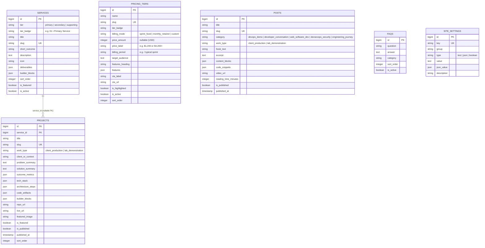

# Phase 02 (Domain Schema, Eloquent Models, Factories & C28 Seeders) — Design Review

**Status:** Design review only — no Phase 02 implementation authorized yet.

---

## 1. Objective

Design and specify the relational database schema, Eloquent models, PHP 8.2+ enums/constants, model factories, and production-grade seeders for **C28 — Software & Cloud Engineering** so that the studio owner can dynamically create, update, reorder, and publish all website content, pricing packages, case studies, lab walkthroughs, FAQs, and site settings from the `/admin` backend without modifying source code.

### User-Visible & Engineering Outcomes
1. **Six Core Domain Tables & Eloquent Models**:
   - `services` (`App\Models\Service`) — 4-tier service hierarchy (`primary`, `secondary`, `supporting`) with structured `deliverables` and dynamic `builder_blocks` JSON.
   - `projects` (`App\Models\Project`) — Case studies and technical demonstrations enforcing the mandatory `AGENTS.md` distinction between `client_production` and `lab_demonstration`, complete with `outcome_metrics`, `tech_stack`, `architecture_steps`, `code_artifacts`, and `builder_blocks` JSON.
   - `pricing_tiers` (`App\Models\PricingTier`) — Dynamic engagement options supporting `sprint_fixed`, `monthly_retainer`, and `custom` billing modes, price amounts/labels, target audience, features list, and CTA controls.
   - `posts` (`App\Models\Post`) — Engineering lab notes, walkthroughs, and insights mapped to the 5 C28 content categories (`devops_demo`, `developer_conversation`, `web_software_dev`, `devsecops_security`, `engineering_journey`) and `work_type` (`client_production` vs `lab_demonstration`), with `content_blocks` and `code_snippets` JSON.
   - `faqs` (`App\Models\Faq`) — Categorized, sortable founder & technical FAQs.
   - `site_settings` (`App\Models\SiteSetting`) — Keyed configuration & JSON payload store powering hero copy, brand statements, interactive hero console tabs, 10-step blueprint defaults, founder bottleneck scenarios, contact metadata, social links, and CTA labels.
2. **Realistic C28 Content Seeding**:
   - Deterministic seeders (`C28ContentSeeder` invoked from `DatabaseSeeder`) populating the exact C28 services, sprint/retainer pricing tiers, lab walkthroughs, real `Dockerfile` / `nginx.conf` / GitHub Actions YAML artifacts, 10-step production blueprint, FAQs, and site settings derived from `c28_landing_page.html` and `AGENTS.md`.
3. **Comprehensive Automated Test Coverage**:
   - Unit and Feature tests verifying schema constraints, JSON casting, query scopes (`active()`, `published()`, `featured()`, `ordered()`), relationships (`Service::projects()`), `work_type` and `category` integrity, and full idempotency of `DatabaseSeeder`.

---

## 2. Existing-State Audit (File Paths and Symbols)

### 2.1 Phase 01 Foundation Files
- `AGENTS.md` — Defines the 4-tier service hierarchy (Section 2), 5 content categories and mandatory `client_production` vs `lab_demonstration` rule (Section 3), locked stack (Section 4), and obsidian/carbon/emerald aesthetic tokens (Section 5).
- `app/Models/User.php` — Implements `Filament\Models\Contracts\FilamentUser` with `is_admin` boolean authorization.
- `app/Providers/Filament/AdminPanelProvider.php` — Configures the `/admin` Filament v3 panel (`C28 Control Plane`).
- `app/Filament/Blocks/.gitkeep` & `resources/views/components/blocks/.gitkeep` — Prepared directories for Filament Builder / NioBuilder block schemas.
- `database/migrations/0001_01_01_000000_create_users_table.php` — Base `users`, `password_reset_tokens`, and `sessions` tables.
- `database/seeders/DatabaseSeeder.php` — Currently seeds only the `admin@c28studios.com` user.
- `c28_landing_page.html` — Contains the reference copy, 4 services (lines 666–758), 3 engagement tiers across `sprint` and `retainer` modes (lines 880–1020, 1795–1818), 6 founder scenarios (lines 1039–1153), 5 FAQs (lines 1184–1240), 3 lab walkthrough articles (lines 1259–1371, 1870–1900), hero console tabs (`pipeline`, `devsecops`, `nginx`, `software` at lines 1537–1578), 3 code snippets (`deploy-production.yml`, `Dockerfile.production`, `c28-app.conf` at lines 1603–1664), and 10-step production blueprint (lines 1683–1764).

---

## 3. Current Architecture and Conventions

- **Framework**: Laravel 11 (`PHP 8.2.30`), Eloquent ORM with typed `casts(): array` methods on models.
- **Database Compatibility**: Migrations must use standard Laravel `Schema` builder types (`string`, `text`, `json`, `boolean`, `integer`, `unsignedInteger`, `timestamp`, `foreignId`) that execute identically on **MySQL 8.0+** (development/production) and **SQLite** (automated PHPUnit tests).
- **Dynamic Content Philosophy**: Every content-heavy entity (`Service`, `Project`, `Post`) includes a JSON block column (`builder_blocks` or `content_blocks`) structured as an array of `{ "type": "<block_slug>", "data": { ... } }` objects, matching Filament v3's native `Forms\Components\Builder` (`Builder\Block`) storage format.

---

## 4. Proposed Design and Data Flow

### 4.1 Entity-Relationship Overview

### 4.2 Detailed Model & Schema Specifications

#### 1. `services` Table & `App\Models\Service`
- **Columns**:
  - `id`: `id()`
  - `tier`: `string('tier', 32)->index()` — Valid values: `'primary'`, `'secondary'`, `'supporting'` (constants defined on `Service`: `TIER_PRIMARY`, `TIER_SECONDARY`, `TIER_SUPPORTING`).
  - `tier_badge`: `string('tier_badge', 64)->nullable()` — e.g., `'01 • Primary Service'`, `'02 • Secondary Service'`, `'03 • Supporting Service'`, `'04 • Supporting Service'`.
  - `title`: `string('title')`
  - `slug`: `string('slug')->unique()`
  - `short_outcome`: `string('short_outcome', 500)`
  - `description`: `text('description')->nullable()`
  - `icon`: `string('icon', 100)->nullable()` — Icon identifier or SVG key.
  - `deliverables`: `json('deliverables')->nullable()` — Array of deliverable bullet strings/objects.
  - `builder_blocks`: `json('builder_blocks')->nullable()` — Filament Builder / NioBuilder dynamic section blocks.
  - `sort_order`: `integer('sort_order')->default(0)->index()`
  - `is_featured`: `boolean('is_featured')->default(false)->index()`
  - `is_active`: `boolean('is_active')->default(true)->index()`
  - `timestamps()`
- **Relationships & Scopes**:
  - `projects(): HasMany` (`$this->hasMany(Project::class)`)
  - `scopeActive(Builder $query)` (`where('is_active', true)`)
  - `scopeFeatured(Builder $query)` (`where('is_featured', true)`)
  - `scopeOrdered(Builder $query)` (`orderBy('sort_order')->orderBy('id')`)

#### 2. `projects` Table & `App\Models\Project`
- **Columns**:
  - `id`: `id()`
  - `service_id`: `foreignId('service_id')->nullable()->constrained('services')->nullOnDelete()`
  - `title`: `string('title')`
  - `slug`: `string('slug')->unique()`
  - `work_type`: `string('work_type', 32)->index()` — Enforces `AGENTS.md` Section 3.2: `'client_production'` (`WORK_TYPE_CLIENT_PRODUCTION`) or `'lab_demonstration'` (`WORK_TYPE_LAB_DEMONSTRATION`).
  - `client_or_context`: `string('client_or_context')->nullable()` — e.g., `'C28 Engineering Lab'` or anonymized/verified client context (`'B2B SaaS Platform'`).
  - `problem_summary`: `text('problem_summary')`
  - `solution_summary`: `text('solution_summary')`
  - `outcome_metrics`: `json('outcome_metrics')->nullable()` — Array of `{ "label": "Release Downtime", "value": "0m" }` objects.
  - `tech_stack`: `json('tech_stack')->nullable()` — Array of tags (`["Docker", "GitHub Actions", "Nginx", "Ubuntu LTS"]`).
  - `architecture_steps`: `json('architecture_steps')->nullable()` — Ordered step objects supporting the 10-step deployment blueprint (`step`, `title`, `category`, `deliverable`, `problem`, `outcome`, `command`).
  - `code_artifacts`: `json('code_artifacts')->nullable()` — Real config/code files (`[{ "title": "Dockerfile.production", "language": "dockerfile", "code": "..." }]`).
  - `builder_blocks`: `json('builder_blocks')->nullable()` — Filament Builder / NioBuilder blocks.
  - `repo_url`: `string('repo_url')->nullable()`
  - `live_url`: `string('live_url')->nullable()`
  - `featured_image`: `string('featured_image')->nullable()`
  - `is_featured`: `boolean('is_featured')->default(false)->index()`
  - `is_published`: `boolean('is_published')->default(false)->index()`
  - `published_at`: `timestamp('published_at')->nullable()->index()`
  - `sort_order`: `integer('sort_order')->default(0)->index()`
  - `timestamps()`
- **Relationships, Helpers & Scopes**:
  - `service(): BelongsTo` (`$this->belongsTo(Service::class)`)
  - `isClientProduction(): bool` / `isLabDemonstration(): bool`
  - `workTypeLabel(): string` (`'Production Client Work'` vs `'C28 Lab Demonstration'`)
  - `scopePublished(Builder $query)` (`where('is_published', true)`)
  - `scopeFeatured(Builder $query)` (`where('is_featured', true)`)
  - `scopeOrdered(Builder $query)` (`orderBy('sort_order')->orderByDesc('published_at')`)

#### 3. `pricing_tiers` Table & `App\Models\PricingTier`
- **Columns**:
  - `id`: `id()`
  - `name`: `string('name')`
  - `slug`: `string('slug')->unique()`
  - `tier_badge`: `string('tier_badge', 100)->nullable()` — e.g., `'01 / LAUNCH READY'`, `'02 / CORE SPECIALIZATION'`, `'03 / END-TO-END STUDIO'`.
  - `billing_mode`: `string('billing_mode', 32)->index()` — `'sprint_fixed'` (`MODE_SPRINT_FIXED`), `'monthly_retainer'` (`MODE_MONTHLY_RETAINER`), `'custom'` (`MODE_CUSTOM`).
  - `price_amount`: `unsignedInteger('price_amount')->nullable()` — Numeric value in USD (e.g., `1200`, `2500`, `4200`, `750`, `1600`, `3200`) for sorting/filtering.
  - `price_label`: `string('price_label', 64)` — Display string (e.g., `'$1,200'`, `'$2,500'`, `'$4,200+'`, `'Custom'`).
  - `billing_period`: `string('billing_period', 100)->nullable()` — e.g., `'/ typical sprint'`, `'/ month DevOps partner'`, `'/ custom build'`.
  - `target_audience`: `text('target_audience')`
  - `features_heading`: `string('features_heading')->nullable()` — e.g., `"What's Included:"`, `"Everything in Launch, plus:"`.
  - `features`: `json('features')` — Array of included deliverable strings.
  - `cta_label`: `string('cta_label', 100)`
  - `cta_url`: `string('cta_url')->nullable()`
  - `is_highlighted`: `boolean('is_highlighted')->default(false)->index()`
  - `is_active`: `boolean('is_active')->default(true)->index()`
  - `sort_order`: `integer('sort_order')->default(0)->index()`
  - `timestamps()`
- **Scopes**:
  - `scopeActive(Builder $query)`, `scopeForBillingMode(Builder $query, string $mode)`, `scopeOrdered(Builder $query)`

#### 4. `posts` Table & `App\Models\Post`
- **Columns**:
  - `id`: `id()`
  - `title`: `string('title')`
  - `slug`: `string('slug')->unique()`
  - `category`: `string('category', 48)->index()` — Maps to the 5 C28 content categories:
    1. `'devops_demo'` (`CATEGORY_DEVOPS_DEMO` — Practical DevOps demonstrations)
    2. `'developer_conversation'` (`CATEGORY_DEVELOPER_CONVERSATION` — Developer conversations)
    3. `'web_software_dev'` (`CATEGORY_WEB_SOFTWARE_DEV` — Website/software development)
    4. `'devsecops_security'` (`CATEGORY_DEVSECOPS_SECURITY` — DevSecOps/security)
    5. `'engineering_journey'` (`CATEGORY_ENGINEERING_JOURNEY` — Personal engineering journey)
  - `work_type`: `string('work_type', 32)->default('lab_demonstration')->index()` — `'client_production'` or `'lab_demonstration'`.
  - `hook_text`: `string('hook_text', 500)->nullable()` — Terminal/card header hook or command preview.
  - `excerpt`: `text('excerpt')`
  - `content_blocks`: `json('content_blocks')->nullable()` — Filament Builder / NioBuilder dynamic content blocks (`heading`, `paragraph`, `terminal_log`, `code_block`, `callout`).
  - `code_snippets`: `json('code_snippets')->nullable()` — Structured code/terminal snippets associated with the article.
  - `video_url`: `string('video_url')->nullable()`
  - `reading_time_minutes`: `unsignedSmallInteger('reading_time_minutes')->default(5)`
  - `is_published`: `boolean('is_published')->default(false)->index()`
  - `published_at`: `timestamp('published_at')->nullable()->index()`
  - `timestamps()`
- **Scopes & Helpers**:
  - `scopePublished(Builder $query)`, `scopeByCategory(Builder $query, string $category)`, `categoryLabel(): string`

#### 5. `faqs` Table & `App\Models\Faq`
- **Columns**:
  - `id`: `id()`
  - `question`: `string('question', 500)`
  - `answer`: `text('answer')`
  - `category`: `string('category', 64)->default('general')->index()` — e.g., `'general'`, `'devops'`, `'devsecops'`, `'ownership'`, `'engagement'`.
  - `sort_order`: `integer('sort_order')->default(0)->index()`
  - `is_active`: `boolean('is_active')->default(true)->index()`
  - `timestamps()`

#### 6. `site_settings` Table & `App\Models\SiteSetting`
- **Columns**:
  - `id`: `id()`
  - `key`: `string('key', 120)->unique()` — e.g., `'brand.name'`, `'brand.statement'`, `'hero.headline'`, `'hero.subheadline'`, `'hero.console_tabs'`, `'blueprint.steps'`, `'scenarios.items'`, `'contact.email'`, `'cta.primary_label'`.
  - `group`: `string('group', 64)->default('general')->index()` — `'brand'`, `'hero'`, `'console'`, `'blueprint'`, `'scenarios'`, `'contact'`, `'social'`, `'cta'`.
  - `type`: `string('type', 32)->default('text')` — `'text'`, `'json'`, `'boolean'`.
  - `value`: `text('value')->nullable()` — Scalar/text value when `type !== 'json'`.
  - `json_value`: `json('json_value')->nullable()` — Structured JSON payload when `type === 'json'`.
  - `description`: `string('description', 500)->nullable()`
  - `timestamps()`
- **Helper API on `SiteSetting`**:
  - `SiteSetting::getValue(string $key, mixed $default = null): mixed` — Returns `json_value` when `type === 'json'`, cast boolean when `type === 'boolean'`, or `value` otherwise, falling back to `$default`.
  - `SiteSetting::setValue(string $key, mixed $value, string $group = 'general', string $type = 'text', ?string $description = null): self` — Idempotent upsert helper.

---

## 5. Data/Storage/Migration Impact

### 5.1 Phase 02 Migrations
All migrations use timestamp prefixes ordered after `0001_01_01_000002_create_jobs_table.php`:
1. `database/migrations/2026_11_13_000001_create_services_table.php`
2. `database/migrations/2026_11_13_000002_create_projects_table.php`
3. `database/migrations/2026_11_13_000003_create_pricing_tiers_table.php`
4. `database/migrations/2026_11_13_000004_create_posts_table.php`
5. `database/migrations/2026_11_13_000005_create_faqs_table.php`
6. `database/migrations/2026_11_13_000006_create_site_settings_table.php`

### 5.2 Idempotent Seeder Design (`database/seeders/C28ContentSeeder.php`)
- Uses `updateOrCreate(['slug' => ...], [...])` (and `['key' => ...]` for `SiteSetting`, `['question' => ...]` for `Faq`) so running `php artisan db:seed` multiple times is 100% idempotent and never creates duplicate rows.
- Seeds:
  - **4 Services** matching the exact C28 hierarchy (`DevOps & Cloud Engineering` [primary], `DevSecOps Integration` [secondary], `Software Development` [supporting], `Website Development` [supporting]).
  - **3 Projects / Technical Demonstrations** with explicit `work_type` (`lab_demonstration` and anonymized `client_production` architecture), real `Dockerfile`, `nginx.conf`, and GitHub Actions YAML `code_artifacts`, and the 10-step production blueprint.
  - **6 Pricing Tiers** (3 `sprint_fixed` tiers: `$1,200`, `$2,500`, `$4,200+`; and 3 `monthly_retainer` tiers: `$750`, `$1,600`, `$3,200`).
  - **5 Posts / Walkthroughs** spanning all 5 C28 content categories (`devops_demo`, `devsecops_security`, `developer_conversation`, `web_software_dev`, `engineering_journey`) with structured `content_blocks` and `code_snippets`.
  - **5 FAQs** from the C28 founder FAQ section.
  - **Site Settings** covering brand identity, hero copy, interactive hero console tabs, 10-step blueprint steps, 6 founder bottleneck scenarios, and contact/CTA configuration.

### 5.3 Rollback Strategy
- `php artisan migrate:rollback` drops `site_settings`, `faqs`, `posts`, `pricing_tiers`, `projects`, and `services` in reverse foreign-key order (`projects` before `services`).

---

## 6. Security, Authorization, Validation, and Privacy

1. **Mandatory Integrity Enforcement**:
   - `Project::WORK_TYPES` and `Post::WORK_TYPES` restrict `work_type` to `['client_production', 'lab_demonstration']`.
   - `Post::CATEGORIES` restricts `category` to `['devops_demo', 'developer_conversation', 'web_software_dev', 'devsecops_security', 'engineering_journey']`.
   - `Service::TIERS` restricts `tier` to `['primary', 'secondary', 'supporting']`.
   - `PricingTier::BILLING_MODES` restricts `billing_mode` to `['sprint_fixed', 'monthly_retainer', 'custom']`.
2. **Zero Fabricated Client Claims**:
   - All seeded demonstrations and walkthroughs strictly follow `AGENTS.md` Section 3.2 (labeled transparently as `lab_demonstration` or verified engineering architectures without fake client names or fake testimonials).
3. **Mass Assignment & Casting Safety**:
   - Explicit `$fillable` arrays and typed `casts()` on all 6 models ensures JSON columns (`deliverables`, `builder_blocks`, `outcome_metrics`, `tech_stack`, `architecture_steps`, `code_artifacts`, `features`, `content_blocks`, `code_snippets`, `json_value`) are safely serialized/deserialized via Eloquent without raw SQL injection vectors.

---

## 7. UX and Accessibility

- Phase 02 is a backend domain schema, model, and seeder phase; no public UI layouts are altered in this phase.
- All seeded JSON structures (`builder_blocks`, `code_artifacts`, `architecture_steps`, `features`) preserve semantic titles, step numbers, reading time estimates, and accessible labels for Phase 03/04 Blade and Filament rendering.

---

## 8. Compatibility and Regression Risks

| Risk Area | Impact | Mitigation |
| :--- | :--- | :--- |
| **MySQL 8.0 vs SQLite JSON Column Defaults** | MySQL 8.0 disallows default values on `JSON` and `TEXT` columns in strict mode unless expressed as expressions, whereas SQLite allows string defaults. | Make all `json` and `text` columns `->nullable()` in migrations and provide default `[]` arrays in Eloquent model attributes/factories. |
| **Foreign Key Deletion (`services` -> `projects`)** | Deleting a `Service` could fail or cascade-delete valuable case studies if not handled carefully. | Use `->nullOnDelete()` on `projects.service_id` so projects remain intact even if a service record is reassigned or removed. |
| **Existing Phase 01 Tests** | Adding `C28ContentSeeder` to `DatabaseSeeder` must not break `FoundationTest`. | Keep `FoundationTest` independent and verify both `FoundationTest` and the new `DomainSchemaTest` pass together. |

---

## 9. Alternatives and Recommendation

1. **Alternative A — Hardcode Services, Blueprint Steps, and Pricing in Blade Config Files**:
   - *Pros*: Fewer database tables.
   - *Cons*: Violates the core requirement that the studio owner must be able to dynamically add/edit projects, services, pricing tiers, case studies, FAQs, and site content from `/admin`.
2. **Alternative B (Recommended) — Relational Tables + Filament Builder / NioBuilder JSON Block Columns + `site_settings` Key/JSON Store**:
   - *Pros*: Gives strong relational integrity and indexing for core queries (`services`, `projects`, `pricing_tiers`, `posts`, `faqs`) while providing flexible JSON block arrays (`builder_blocks`, `content_blocks`) and `site_settings` for rich custom page sections in Filament v3.

---

## 10. Expected File Impact (Stage B of Phase 02)

### Files to Create
- **Migrations**:
  - `database/migrations/2026_11_13_000001_create_services_table.php`
  - `database/migrations/2026_11_13_000002_create_projects_table.php`
  - `database/migrations/2026_11_13_000003_create_pricing_tiers_table.php`
  - `database/migrations/2026_11_13_000004_create_posts_table.php`
  - `database/migrations/2026_11_13_000005_create_faqs_table.php`
  - `database/migrations/2026_11_13_000006_create_site_settings_table.php`
- **Models**:
  - `app/Models/Service.php`
  - `app/Models/Project.php`
  - `app/Models/PricingTier.php`
  - `app/Models/Post.php`
  - `app/Models/Faq.php`
  - `app/Models/SiteSetting.php`
- **Factories**:
  - `database/factories/ServiceFactory.php`
  - `database/factories/ProjectFactory.php`
  - `database/factories/PricingTierFactory.php`
  - `database/factories/PostFactory.php`
  - `database/factories/FaqFactory.php`
  - `database/factories/SiteSettingFactory.php`
- **Seeders**:
  - `database/seeders/C28ContentSeeder.php`
- **Tests**:
  - `tests/Feature/DomainSchemaTest.php`
- **Stage D Documentation (after Stage B/C)**:
  - `docs/c28-web/phase-02-domain-schema-and-models/02-implementation.md`
  - `docs/c28-web/phase-02-domain-schema-and-models/03-acceptance.md`

### Files to Modify
- `database/seeders/DatabaseSeeder.php` — Call `$this->call(C28ContentSeeder::class);`.

---

## 11. Verification Plan (Phase 02 Stage C)

1. **Automated PHPUnit Test Suite (`php artisan test`)**:
   - `tests/Feature/DomainSchemaTest.php`:
     - Verifies `Service` creation, JSON casting (`deliverables`, `builder_blocks`), and 4-tier hierarchy ordering.
     - Verifies `Project` creation, `BelongsTo` relationship with `Service`, `work_type` (`client_production` vs `lab_demonstration`) helpers, and JSON casting (`outcome_metrics`, `tech_stack`, `architecture_steps`, `code_artifacts`, `builder_blocks`).
     - Verifies `PricingTier` creation and `forBillingMode('sprint_fixed')` / `forBillingMode('monthly_retainer')` filtering.
     - Verifies `Post` creation across all 5 C28 categories (`devops_demo`, `developer_conversation`, `web_software_dev`, `devsecops_security`, `engineering_journey`) and `work_type` enforcement.
     - Verifies `Faq` ordering and `active()` scope.
     - Verifies `SiteSetting::setValue()` and `SiteSetting::getValue()` for text, boolean, and JSON settings.
     - Verifies `C28ContentSeeder` populates all 6 tables cleanly and is idempotent when executed twice.
2. **Migration & Rollback Check**:
   - Verify `RefreshDatabase` migrations and rollback execute cleanly without errors.

---

## 12. Risks, Assumptions, and Open Questions

- **Assumption**: `price_amount` on `pricing_tiers` is stored as an integer representing whole USD dollars (e.g., `1200` for `$1,200`), while `price_label` stores the formatted display label (`"$1,200"`, `"$4,200+"`, or `"Custom"`), allowing both numeric sorting and flexible display formatting.
- **No Blocking Questions**: All table names, column names, enum/constant values, and JSON structures match the user specification and `AGENTS.md`.

---

## 13. Rollout and Rollback

- **Rollout**: Create migrations, Eloquent models, factories, `C28ContentSeeder`, and `DomainSchemaTest.php`, then run `php artisan test`.
- **Rollback**: Run `php artisan migrate:rollback` and remove the Phase 02 model/migration/factory/seeder/test files.

---

**Stage A complete — design review only. No Phase 02 implementation files were changed. Awaiting explicit approval to begin Phase 02 implementation.**

