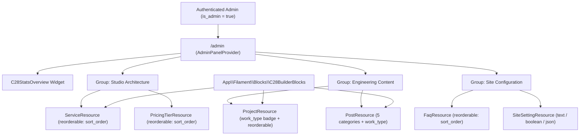

# Phase 03 (Filament v3 `/admin` CMS Control Plane & Reusable Builder Block Library) — Design Review

**Status:** Design review only — no Phase 03 implementation authorized yet.

---

## 1. Objective

Design and specify the **FilamentPHP v3 `/admin` CMS Control Plane**, the reusable **C28 Builder / NioBuilder Block Library** (`app/Filament/Blocks/C28BuilderBlocks.php`), the 6 Filament Resources (`ServiceResource`, `ProjectResource`, `PricingTierResource`, `PostResource`, `FaqResource`, `SiteSettingResource`), and the C28 Control Plane Dashboard Widget (`app/Filament/Widgets/C28StatsOverview.php`).

### User-Visible & Engineering Outcomes
1. **Reusable Visual Block Builder (`App\Filament\Blocks\C28BuilderBlocks`)**:
   - Provides 7 structured `Filament\Forms\Components\Builder\Block` schemas (`hero_terminal`, `architecture_step_list`, `code_artifact_viewer`, `metric_callout_grid`, `problem_solution_split`, `markdown_prose`, `cta_banner`) that plug directly into `ServiceResource`, `ProjectResource`, and `PostResource` so the studio owner can visually assemble and reorder dynamic page sections without writing HTML.
2. **Six Full-Featured Filament v3 Resources in `/admin`**:
   - Grouped into logical sidebar navigation groups (`Studio Architecture`, `Engineering Content`, `Site Configuration`) with live navigation count badges, filterable/searchable tables, inline boolean toggles (`ToggleColumn` for `is_active`, `is_published`, `is_featured`, `is_highlighted`), and drag-and-drop ordering (`->reorderable('sort_order')`).
3. **Mandatory Integrity Enforcement in the CMS UI**:
   - `ProjectResource` and `PostResource` enforce explicit selection and visual badge coloring (`success` for `client_production`, `info` for `lab_demonstration`) for the mandatory `AGENTS.md` client vs. lab distinction rule.
4. **C28 Control Plane Overview Widget (`C28StatsOverview`)**:
   - Displays real-time counts on `/admin` for Active Services (4-tier hierarchy), Published Projects (broken down by `Client Production` vs `Lab Demonstration`), Active Pricing Tiers (`Sprint` vs `Retainer`), and Published Engineering Posts across the 5 content categories.

---

## 2. Existing-State Audit (File Paths and Symbols)

### 2.1 Existing Foundation & Domain Layer (Phases 01–02)
- `app/Providers/Filament/AdminPanelProvider.php` — Configures the `/admin` panel (`id('admin')`, `path('admin')`, `brandName('C28 Control Plane')`, `darkMode(true)`, `Color::Emerald`) with auto-discovery in:
  - `app/Filament/Resources` (`App\Filament\Resources`)
  - `app/Filament/Pages` (`App\Filament\Pages`)
  - `app/Filament/Widgets` (`App\Filament\Widgets`)
- `app/Models/User.php` — Implements `FilamentUser::canAccessPanel(Panel $panel): bool` enforcing `(bool) $this->is_admin`.
- **Phase 02 Domain Models**:
  - `app/Models/Service.php` (`TIERS`, `deliverables`, `builder_blocks`, `sort_order`, `is_featured`, `is_active`)
  - `app/Models/Project.php` (`WORK_TYPES`, `service_id`, `outcome_metrics`, `tech_stack`, `architecture_steps`, `code_artifacts`, `builder_blocks`, `is_featured`, `is_published`, `published_at`, `sort_order`)
  - `app/Models/PricingTier.php` (`BILLING_MODES`, `price_amount`, `price_label`, `billing_period`, `features_heading`, `features`, `cta_label`, `cta_url`, `is_highlighted`, `is_active`, `sort_order`)
  - `app/Models/Post.php` (`CATEGORIES`, `WORK_TYPES`, `hook_text`, `excerpt`, `content_blocks`, `code_snippets`, `video_url`, `reading_time_minutes`, `is_published`, `published_at`)
  - `app/Models/Faq.php` (`question`, `answer`, `category`, `sort_order`, `is_active`)
  - `app/Models/SiteSetting.php` (`TYPE_TEXT`, `TYPE_JSON`, `TYPE_BOOLEAN`, `key`, `group`, `type`, `value`, `json_value`, `description`)
- `app/Filament/Blocks/.gitkeep` — Prepared namespace directory for `C28BuilderBlocks`.

---

## 3. Current Architecture and Conventions

- **FilamentPHP v3 (`v3.3.57`) + Livewire v3 (`v3.8.11`)**:
  - Resources live under `app/Filament/Resources/<Name>Resource.php` with companion page classes in `app/Filament/Resources/<Name>Resource/Pages/{List,Create,Edit}<Plural>.php`.
  - JSON array columns (`deliverables`, `features`, `tech_stack`, `outcome_metrics`, `architecture_steps`, `code_artifacts`, `code_snippets`) map cleanly to Filament's `TagsInput`, `Repeater`, and `KeyValue` form components.
  - Dynamic page/article block columns (`builder_blocks`, `content_blocks`) map to `Filament\Forms\Components\Builder` using reusable `Builder\Block` definitions from `App\Filament\Blocks\C28BuilderBlocks`.

---

## 4. Proposed Design and Data Flow

### 4.1 Admin Control Plane & Builder Architecture

### 4.2 Reusable Builder Block Library (`app/Filament/Blocks/C28BuilderBlocks.php`)
`C28BuilderBlocks::make(string $fieldName = 'builder_blocks', string $label = 'Dynamic Content Blocks'): Builder` returns a pre-configured `Filament\Forms\Components\Builder` component with collapsible, cloneable, reorderable blocks:

1. **`hero_terminal`** (`Hero / Terminal Stream`):
   - Fields: `window_title` (`TextInput`, required), `ssh_target` (`TextInput`), `status_badge` (`TextInput`), `logs` (`Repeater` of `timestamp`, `message`, `status`), `outcome_summary` (`Textarea`).
2. **`architecture_step_list`** (`10-Step Architecture Sequence`):
   - Fields: `section_heading` (`TextInput`), `steps` (`Repeater` of `step` [`01`..`10`], `category`, `title`, `deliverable`, `problem`, `outcome`, `cmd`).
3. **`code_artifact_viewer`** (`Engineering Config / Code Artifact`):
   - Fields: `title` (`TextInput`, e.g., `Dockerfile.production` or `nginx.conf`), `language` (`Select`: `yaml`, `dockerfile`, `nginx`, `bash`, `php`, `javascript`, `json`), `code` (`Textarea` with monospace font), `caption` (`TextInput`).
4. **`metric_callout_grid`** (`Outcome Metric Callout Grid`):
   - Fields: `heading` (`TextInput`), `metrics` (`Repeater` of `value` [e.g., `0m`, `99.98%`, `-32%`], `label` [e.g., `Release Downtime`], `note`).
5. **`problem_solution_split`** (`Problem vs. C28 Solution Split`):
   - Fields: `badge` (`TextInput`), `problem_heading` (`TextInput`), `problem` (`Textarea`, required), `solution_heading` (`TextInput`), `solution` (`Textarea`, required), `verification_cmd` (`TextInput`).
6. **`markdown_prose`** (`Structured Engineering Prose Section`):
   - Fields: `heading` (`TextInput`), `body` (`MarkdownEditor` / `Textarea`, required).
7. **`cta_banner`** (`Call-to-Action Banner`):
   - Fields: `badge` (`TextInput`), `heading` (`TextInput`, required), `subtext` (`Textarea`), `button_label` (`TextInput`, required), `button_url` (`TextInput`, default `#consultation`).

### 4.3 Filament Resource Specifications

#### 1. `ServiceResource` (`Studio Architecture`, Sort 1)
- **Form Schema**:
  - `Section::make('Service Identity & Hierarchy')`: `title` (auto-generates `slug` on create), `slug` (unique), `tier` (`Select` with `Service::TIERS`, required), `tier_badge` (`TextInput`), `icon` (`TextInput`), `sort_order` (`TextInput::numeric()`), `is_featured` (`Toggle`), `is_active` (`Toggle`).
  - `Section::make('Outcome & Deliverables')`: `short_outcome` (`Textarea`, required), `description` (`Textarea`), `deliverables` (`Repeater` or `TagsInput` / simple list of strings).
  - `Section::make('Dynamic Page Blocks')`: `C28BuilderBlocks::make('builder_blocks')`.
- **Table Schema**:
  - `->reorderable('sort_order')`, `->defaultSort('sort_order')`
  - Columns: `sort_order`, `tier_badge` (badge), `title` (searchable), `tier` (badge colored by `primary` -> `success`, `secondary` -> `info`, `supporting` -> `gray`), `projects_count` (`counts('projects')`), `is_featured` (`ToggleColumn`), `is_active` (`ToggleColumn`).
  - Filters: `SelectFilter::make('tier')->options(Service::TIERS)`, `TernaryFilter::make('is_active')`.

#### 2. `ProjectResource` (`Engineering Content`, Sort 1)
- **Form Schema**:
  - `Tabs` layout:
    - **Tab 1: Overview & Work Classification**: `title` (auto-slug), `slug` (unique), `work_type` (`Select` with `Project::WORK_TYPES`, required, helper text enforcing `AGENTS.md` integrity rule), `service_id` (`Select::relationship('service', 'title')`), `client_or_context`, `problem_summary` (`Textarea`, required), `solution_summary` (`Textarea`, required).
    - **Tab 2: Metrics, Stack & Links**: `outcome_metrics` (`Repeater` of `label`, `value`), `tech_stack` (`TagsInput`), `repo_url`, `live_url`, `featured_image`, `is_featured` (`Toggle`), `is_published` (`Toggle`), `published_at` (`DateTimePicker`), `sort_order` (`TextInput::numeric()`).
    - **Tab 3: Architecture Blueprint & Code Artifacts**: `architecture_steps` (`Repeater` of `step`, `category`, `title`, `deliverable`, `problem`, `outcome`, `cmd`), `code_artifacts` (`Repeater` of `title`, `language`, `code`).
    - **Tab 4: Visual Builder Blocks**: `C28BuilderBlocks::make('builder_blocks')`.
- **Table Schema**:
  - `->reorderable('sort_order')`, `->defaultSort('sort_order')`
  - Columns: `sort_order`, `title` (searchable), `work_type` (badge: `client_production` -> `success`, `lab_demonstration` -> `info`), `service.title`, `is_featured` (`ToggleColumn`), `is_published` (`ToggleColumn`), `published_at` (`dateTime`).
  - Filters: `SelectFilter::make('work_type')->options(Project::WORK_TYPES)`, `SelectFilter::make('service_id')->relationship('service', 'title')`, `TernaryFilter::make('is_published')`.

#### 3. `PricingTierResource` (`Studio Architecture`, Sort 2)
- **Form Schema**:
  - `name` (auto-slug), `slug` (unique), `tier_badge`, `billing_mode` (`Select` with `PricingTier::BILLING_MODES`, required), `price_amount` (`TextInput::numeric()`), `price_label` (required, e.g., `$1,200` or `$4,200+`), `billing_period` (e.g., `/ typical sprint`), `target_audience` (`Textarea`, required), `features_heading`, `features` (`TagsInput` or `Repeater`), `cta_label` (required), `cta_url`, `is_highlighted` (`Toggle`), `is_active` (`Toggle`), `sort_order` (`TextInput::numeric()`).
- **Table Schema**:
  - `->reorderable('sort_order')`, `->defaultSort('sort_order')`
  - Columns: `sort_order`, `tier_badge`, `name` (searchable), `billing_mode` (badge), `price_label` (font-mono), `billing_period`, `is_highlighted` (`ToggleColumn`), `is_active` (`ToggleColumn`).
  - Filters: `SelectFilter::make('billing_mode')->options(PricingTier::BILLING_MODES)`, `TernaryFilter::make('is_active')`.

#### 4. `PostResource` (`Engineering Content`, Sort 2)
- **Form Schema**:
  - `title` (auto-slug), `slug` (unique), `category` (`Select` with `Post::CATEGORIES`, required), `work_type` (`Select` with `Post::WORK_TYPES`, required), `hook_text` (`TextInput`), `excerpt` (`Textarea`, required), `reading_time_minutes` (`TextInput::numeric()`), `video_url`, `is_published` (`Toggle`), `published_at` (`DateTimePicker`).
  - `code_snippets` (`Repeater` of `title`, `language`, `code`).
  - `C28BuilderBlocks::make('content_blocks', 'Article Content Blocks')`.
- **Table Schema**:
  - `->defaultSort('published_at', 'desc')`
  - Columns: `title` (searchable), `category` (badge formatted via `Post::CATEGORIES`), `work_type` (badge), `reading_time_minutes`, `is_published` (`ToggleColumn`), `published_at` (`dateTime`).
  - Filters: `SelectFilter::make('category')->options(Post::CATEGORIES)`, `SelectFilter::make('work_type')->options(Post::WORK_TYPES)`, `TernaryFilter::make('is_published')`.

#### 5. `FaqResource` (`Site Configuration`, Sort 1)
- **Form Schema**:
  - `question` (`TextInput`, required, maxLength 500), `category` (`Select`: `general`, `devops`, `devsecops`, `ownership`, `engagement`), `answer` (`Textarea`, required), `sort_order` (`TextInput::numeric()`), `is_active` (`Toggle`).
- **Table Schema**:
  - `->reorderable('sort_order')`, `->defaultSort('sort_order')`
  - Columns: `sort_order`, `question` (searchable, limit 60), `category` (badge), `is_active` (`ToggleColumn`).
  - Filters: `SelectFilter::make('category')`, `TernaryFilter::make('is_active')`.

#### 6. `SiteSettingResource` (`Site Configuration`, Sort 2)
- **Form Schema**:
  - `key` (`TextInput`, required, unique), `group` (`Select`: `brand`, `hero`, `console`, `blueprint`, `scenarios`, `contact`, `social`, `cta`, `general`), `type` (`Select`: `text`, `boolean`, `json`, live/reactive), `description` (`TextInput`).
  - Dynamic value input based on `type`:
    - When `type === 'text'`: `Textarea::make('value')`
    - When `type === 'boolean'`: `Select::make('value')->options(['1' => 'Enabled (true)', '0' => 'Disabled (false)'])`
    - When `type === 'json'`: `Textarea::make('json_value_raw')` / JSON editor or structured key-value handler that dehydrates/hydrates `json_value` cleanly so complex nested JSON arrays (like `blueprint.steps` or `hero.console_tabs`) can be viewed and edited safely in `/admin`.
- **Table Schema**:
  - Columns: `key` (searchable, font-mono), `group` (badge), `type` (badge), `description` (limit 60), `updated_at`.
  - Filters: `SelectFilter::make('group')`, `SelectFilter::make('type')`.

### 4.4 Control Plane Overview Widget (`app/Filament/Widgets/C28StatsOverview.php`)
- Extends `Filament\Widgets\StatsOverviewWidget`:
  1. **Active Services**: `Service::query()->active()->count()` (`4-Tier Hierarchy: Primary DevOps -> DevSecOps -> Software -> Web`)
  2. **Published Projects**: `Project::query()->published()->count()` (with description showing breakdown: e.g., `1 Client Production • 2 Lab Demonstrations`)
  3. **Active Pricing Tiers**: `PricingTier::query()->active()->count()` (breakdown of `Fixed Sprints` vs `Monthly Retainers`)
  4. **Published Lab Notes & Posts**: `Post::query()->published()->count()` (`Across 5 C28 Engineering Categories`)

---

## 5. Data/Storage/Migration Impact

- **Zero Schema Changes Required**: All 6 tables (`services`, `projects`, `pricing_tiers`, `posts`, `faqs`, `site_settings`) and their JSON columns (`deliverables`, `builder_blocks`, `outcome_metrics`, `tech_stack`, `architecture_steps`, `code_artifacts`, `features`, `content_blocks`, `code_snippets`, `json_value`) were created and verified in Phase 02.

---

## 6. Security, Authorization, Validation, and Privacy

1. **Panel-Level Authorization**:
   - Every Filament Resource and Widget is mounted inside the `admin` panel (`AdminPanelProvider`) protected by `Authenticate` middleware and `User::canAccessPanel(Panel $panel): bool` (`(bool) $this->is_admin`). Non-admin users receive `403 Forbidden` on all `/admin/*` resource routes.
2. **Server-Side Form Validation**:
   - All resource forms enforce required fields, max lengths, unique slugs (`unique(ignoreRecord: true)`), and strict enum option lists (`Service::TIERS`, `Project::WORK_TYPES`, `PricingTier::BILLING_MODES`, `Post::CATEGORIES`).

---

## 7. UX and Accessibility

- **Sidebar Navigation Organization**:
  - `Studio Architecture`: Services, Pricing Tiers
  - `Engineering Content`: Projects & Case Studies, Engineering Posts
  - `Site Configuration`: FAQs, Site Settings
- **Monospace Code Editing**:
  - Code artifact and JSON editors use monospace styling (`extraInputAttributes(['class' => 'font-mono text-xs'])`) for clear readability of `Dockerfile`, `nginx.conf`, and GitHub Actions YAML snippets inside the dark-mode Filament panel.

---

## 8. Compatibility and Regression Risks

| Risk Area | Impact | Mitigation |
| :--- | :--- | :--- |
| **Nested JSON Editing in `SiteSettingResource`** | Filament's `KeyValue` component only supports flat 1-level string maps, whereas `hero.console_tabs`, `blueprint.steps`, and `scenarios.items` are multi-level nested JSON arrays. | In `SiteSettingResource`, provide a formatted JSON `Textarea` (with `formatStateUsing` `json_encode(..., JSON_PRETTY_PRINT)` and `dehydrateStateUsing` `json_decode(..., true)` + JSON syntax validation rule) when `type === 'json'` so arbitrarily nested JSON structures never get flattened or corrupted. |
| **Deliverables & Features Array Format** | `Service::$deliverables` and `PricingTier::$features` are seeded as flat arrays of strings (`["item 1", "item 2"]`). | Use `TagsInput` (or `Repeater::simple(TextInput::make(...))` / flat array binding) so seeded string arrays load and save without schema mismatch. |

---

## 9. Alternatives and Recommendation

1. **Alternative A — Separate Custom Livewire Admin Pages**:
   - *Cons*: High maintenance boilerplate, inconsistent table filtering/reordering.
2. **Alternative B (Recommended) — Standard Filament v3 Resources + Centralized `C28BuilderBlocks` Library**:
   - *Pros*: Native drag-and-drop table reordering (`->reorderable('sort_order')`), instant `ToggleColumn` publishing switches, unified Builder blocks across Services, Projects, and Posts, and full Livewire testability via `Livewire::test(...)` and HTTP route assertions.

---

## 10. Expected File Impact (Stage B of Phase 03)

### Files to Create
- `app/Filament/Blocks/C28BuilderBlocks.php`
- `app/Filament/Widgets/C28StatsOverview.php`
- `app/Filament/Resources/ServiceResource.php`
- `app/Filament/Resources/ServiceResource/Pages/ListServices.php`
- `app/Filament/Resources/ServiceResource/Pages/CreateService.php`
- `app/Filament/Resources/ServiceResource/Pages/EditService.php`
- `app/Filament/Resources/ProjectResource.php`
- `app/Filament/Resources/ProjectResource/Pages/ListProjects.php`
- `app/Filament/Resources/ProjectResource/Pages/CreateProject.php`
- `app/Filament/Resources/ProjectResource/Pages/EditProject.php`
- `app/Filament/Resources/PricingTierResource.php`
- `app/Filament/Resources/PricingTierResource/Pages/ListPricingTiers.php`
- `app/Filament/Resources/PricingTierResource/Pages/CreatePricingTier.php`
- `app/Filament/Resources/PricingTierResource/Pages/EditPricingTier.php`
- `app/Filament/Resources/PostResource.php`
- `app/Filament/Resources/PostResource/Pages/ListPosts.php`
- `app/Filament/Resources/PostResource/Pages/CreatePost.php`
- `app/Filament/Resources/PostResource/Pages/EditPost.php`
- `app/Filament/Resources/FaqResource.php`
- `app/Filament/Resources/FaqResource/Pages/ListFaqs.php`
- `app/Filament/Resources/FaqResource/Pages/CreateFaq.php`
- `app/Filament/Resources/FaqResource/Pages/EditFaq.php`
- `app/Filament/Resources/SiteSettingResource.php`
- `app/Filament/Resources/SiteSettingResource/Pages/ListSiteSettings.php`
- `app/Filament/Resources/SiteSettingResource/Pages/CreateSiteSetting.php`
- `app/Filament/Resources/SiteSettingResource/Pages/EditSiteSetting.php`
- `tests/Feature/AdminCmsResourcesTest.php`
- `docs/c28-web/phase-03-admin-cms-and-builder/02-implementation.md` (Stage D)
- `docs/c28-web/phase-03-admin-cms-and-builder/03-acceptance.md` (Stage D)

### Files to Modify
- `app/Providers/Filament/AdminPanelProvider.php` — Register `C28StatsOverview::class` in `->widgets([...])`.

---

## 11. Verification Plan (Phase 03 Stage C)

1. **Automated Feature & Livewire Test Suite (`tests/Feature/AdminCmsResourcesTest.php`)**:
   - Verify all 6 resource list pages (`/admin/services`, `/admin/projects`, `/admin/pricing-tiers`, `/admin/posts`, `/admin/faqs`, `/admin/site-settings`) return `200 OK` for an authenticated admin and `403 Forbidden` for a non-admin user.
   - Verify creating and editing records via Livewire resource pages (`CreateService`, `CreateProject`, `EditPricingTier`, `CreatePost`, `CreateFaq`, `EditSiteSetting`), including persisting `C28BuilderBlocks` JSON payloads (`hero_terminal`, `code_artifact_viewer`, `problem_solution_split`, `markdown_prose`, etc.) and validating required fields (`work_type`, `tier`, `category`).
2. **Route & Widget Discovery Check**:
   - Run `php artisan route:list --path=admin` to confirm all 6 resource CRUD route groups are registered.

---

## 12. Risks, Assumptions, and Open Questions

- **No Blocking Questions**: All resource structures, builder blocks (`hero_terminal`, `architecture_step_list`, `code_artifact_viewer`, `metric_callout_grid`, `problem_solution_split`, `markdown_prose`, `cta_banner`), and model fields align 100% with the Phase 02 schema and user specification.

---

## 13. Rollout and Rollback

- **Rollout**: Create `C28BuilderBlocks`, `C28StatsOverview`, the 6 Filament Resources + Page classes, and `AdminCmsResourcesTest.php`, then verify with `php artisan test`.
- **Rollback**: Remove the Phase 03 classes under `app/Filament/` and `tests/Feature/AdminCmsResourcesTest.php`.

---

**Stage A complete — design review only. No Phase 03 implementation files were changed. Awaiting explicit approval to begin Phase 03 implementation.**

