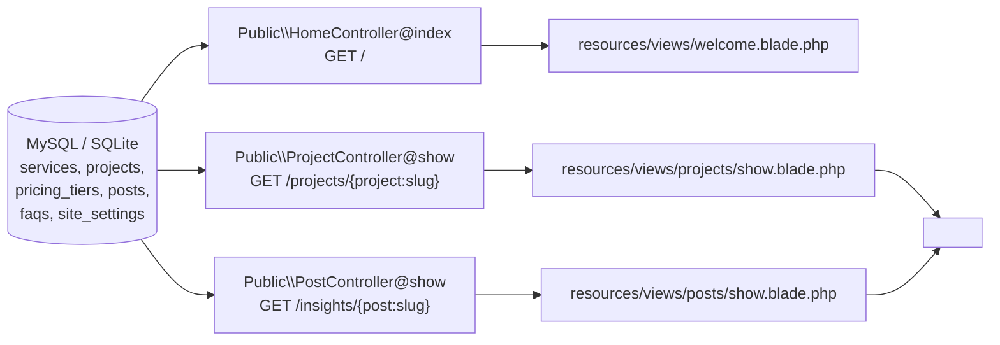

# Phase 04 (Dynamic Public Frontend, Case Study & Insight Pages, and Blade Builder Block Components) — Design Review

**Status:** Design review only — no Phase 04 implementation authorized yet.

---

## 1. Objective

Transform the C28 public frontend from a static foundation placeholder into a **100% database-driven, high-craft dark/emerald engineering platform** powered by Laravel Blade, Alpine.js, Vanilla JS, and Tailwind CSS v3.4 (`c28_landing_page.html` decomposed into dynamic Blade views and reusable Builder block components), so that every edit made in the `/admin` Filament Control Plane immediately updates the live website.

### User-Visible & Engineering Outcomes
1. **Dynamic Homepage (`GET /` -> `HomeController@index`)**:
   - Renders live database records from all 6 Phase 02/03 models (`SiteSetting`, `Service`, `Project`, `PricingTier`, `Post`, `Faq`):
     - **Top Status Bar & Sticky Navbar**: Driven by `SiteSetting` (`brand.name`, `cta.primary_label`).
     - **Hero & Interactive Control Plane Console**: Driven by `SiteSetting` (`hero.badge`, `hero.headline`, `hero.subheadline`, `hero.console_tabs`) with live tab switching (`pipeline`, `devsecops`, `nginx`, `software`) and simulated push deployment.
     - **Outcome-First Bento Grid & Code Artifact Switcher**: Driven by featured `Project` code artifacts (`deploy-production.yml`, `Dockerfile.production`, `/etc/nginx/conf.d/c28-app.conf`) with interactive snippet switching.
     - **4-Tier Unified Service Hierarchy Section (`#services`)**: Driven by `Service::query()->active()->ordered()->get()`, preserving the exact C28 hierarchy (`01 • Primary Service: DevOps & Cloud Engineering`, `02 • Secondary Service: DevSecOps Integration`, `03 • Supporting Service: Software Development`, `04 • Supporting Service: Website Development`) and their dynamic deliverables.
     - **Interactive 10-Step Production Blueprint (`#blueprint`)**: Driven by `SiteSetting::getValue('blueprint.steps')`, allowing visitors to click Steps `01` through `10` to inspect problem, deliverable, outcome, and terminal verification command.
     - **Featured Case Studies & Lab Demonstrations Section (`#projects`)**: Driven by `Project::query()->published()->ordered()->get()`, displaying explicit `Production Client Work` vs `C28 Lab Demonstration` badges (`AGENTS.md` Section 3.2), outcome metrics, tech stack pills, and links to full case study detail views (`/projects/{project:slug}`).
     - **Dynamic Engagement & Pricing Section (`#engagement`)**: Driven by `PricingTier::query()->active()->ordered()->get()`, featuring the interactive toggle between **Fixed-Scope Project Sprint** (`sprint_fixed`) and **Ongoing Engineering Retainer** (`monthly_retainer`) modes, rendering live database prices (`$1,200`, `$2,500`, `$4,200+` / `$750`, `$1,600`, `$3,200`) and features.
     - **Founder Bottleneck Scenarios (`#scenarios`)**: Driven by `SiteSetting::getValue('scenarios.items')` (`S1`–`S6`).
     - **Split Founder FAQ Accordion (`#faq`)**: Driven by `Faq::query()->active()->ordered()->get()`.
     - **Practical Engineering Walkthroughs & Lab Notes (`#insights`)**: Driven by `Post::query()->published()->ordered()->get()` across the 5 C28 content categories, with both quick-preview modal support and dedicated detail URLs (`/insights/{post:slug}`).
2. **Dedicated Case Study Detail Page (`GET /projects/{project:slug}` -> `ProjectController@show`)**:
   - Displays the full architectural case study or lab demonstration: explicit `work_type` badge (`Production Client Work` vs `C28 Lab Demonstration`), problem & solution summaries, verified outcome metrics, tech stack tags, interactive code artifacts (`Dockerfile`, `nginx.conf`, GitHub Actions YAML), architecture steps, and dynamic `builder_blocks` rendered via `<x-blocks.renderer :blocks="$project->builder_blocks" />`.
3. **Dedicated Engineering Insight / Walkthrough Page (`GET /insights/{post:slug}` -> `PostController@show`)**:
   - Displays the full engineering walkthrough: category badge (one of the 5 C28 categories), `work_type` badge, reading time, terminal hook, `content_blocks` rendered via `<x-blocks.renderer :blocks="$post->content_blocks" />`, and `code_snippets`.
4. **Reusable Blade Builder Block Components (`resources/views/components/blocks/`)**:
   - Renders all 7 `C28BuilderBlocks` types (`hero_terminal`, `architecture_step_list`, `code_artifact_viewer`, `metric_callout_grid`, `problem_solution_split`, `markdown_prose`, `cta_banner`) with strict Blade output escaping (`{{ }}`).

---

## 2. Existing-State Audit (File Paths and Symbols)

- `routes/web.php` — Currently contains only the default closure route `Route::get('/', fn () => view('welcome'));`.
- `resources/views/layouts/app.blade.php` — Public master layout loading Google Fonts (`Plus Jakarta Sans`, `JetBrains Mono`) and `@vite(['resources/css/app.css', 'resources/js/app.js'])`.
- `resources/views/welcome.blade.php` — Phase 01 foundation shell.
- `resources/css/app.css` & `tailwind.config.js` — Already configured with C28 obsidian (`#050806`, `#040705`), carbon (`#0A100D`), and glowing emerald (`#10B981`, `#00E676`, `#4ade80`) tokens and classes (`.bg-carbon-grid`, `.hero-beam`, `.vertical-light-pillar`, `.glass-card`, `.glass-card-highlight`, `.btn-emerald`, `.section-badge`).
- `c28_landing_page.html` — 1,924-line reference prototype containing all layout sections and Vanilla JS interactive controllers.
- `app/Filament/Blocks/C28BuilderBlocks.php` — Defines the 7 block schemas stored in `services.builder_blocks`, `projects.builder_blocks`, and `posts.content_blocks`.

---

## 3. Current Architecture and Conventions

- **Strict Script Isolation (`AGENTS.md` Section 4)**:
  - Public views extend `resources/views/layouts/app.blade.php` and load `@vite(['resources/css/app.css', 'resources/js/app.js'])`.
  - Interactive client-side behavior (console tab switching, code artifact tab switching, 10-step blueprint node inspector, sprint/retainer pricing mode switcher, FAQ accordion, consultation modal) is initialized in `resources/js/app.js` reading JSON data attributes or `window.__C28_STATE__` hydrated safely from database records via `@js(...)`.
- **Strict Output Escaping (`AGENTS.md` Section 6.3)**:
  - All database strings and JSON block values are rendered with escaped `{{ }}` syntax (or `@js(...)` inside script data payloads).

---

## 4. Proposed Design and Data Flow

### 4.1 Request & Rendering Data Flow

### 4.2 Controllers & Routes (`routes/web.php`)
1. `GET /` (`name('home')`) -> `App\Http\Controllers\Public\HomeController@index`:
   - Queries:
     - `$services = Service::query()->active()->ordered()->get();`
     - `$projects = Project::query()->with('service')->published()->ordered()->get();`
     - `$sprintTiers = PricingTier::query()->active()->forBillingMode(PricingTier::MODE_SPRINT_FIXED)->ordered()->get();`
     - `$retainerTiers = PricingTier::query()->active()->forBillingMode(PricingTier::MODE_MONTHLY_RETAINER)->ordered()->get();`
     - `$posts = Post::query()->published()->ordered()->limit(6)->get();`
     - `$faqs = Faq::query()->active()->ordered()->get();`
     - `$settings`: Keyed map of `SiteSetting` values with sensible fallbacks (`brand.name`, `brand.statement`, `hero.badge`, `hero.headline`, `hero.subheadline`, `hero.console_tabs`, `blueprint.steps`, `scenarios.items`, `contact.email`, `social.github_url`, `cta.primary_label`) so `GET /` renders gracefully even on an unseeded test database while immediately reflecting any seeded or admin-edited values.
2. `GET /projects/{project:slug}` (`name('projects.show')`) -> `App\Http\Controllers\Public\ProjectController@show`:
   - Aborts with `404` if `! $project->is_published`.
   - Renders `resources/views/projects/show.blade.php`.
3. `GET /insights/{post:slug}` (`name('posts.show')`) -> `App\Http\Controllers\Public\PostController@show`:
   - Aborts with `404` if `! $post->is_published`.
   - Renders `resources/views/posts/show.blade.php`.

### 4.3 Reusable Blade Builder Block Components (`resources/views/components/blocks/`)
- `resources/views/components/blocks/renderer.blade.php`: Loops over `$blocks` array and dispatches to the matching block component:
  - `resources/views/components/blocks/hero_terminal.blade.php`
  - `resources/views/components/blocks/architecture_step_list.blade.php`
  - `resources/views/components/blocks/code_artifact_viewer.blade.php`
  - `resources/views/components/blocks/metric_callout_grid.blade.php`
  - `resources/views/components/blocks/problem_solution_split.blade.php`
  - `resources/views/components/blocks/markdown_prose.blade.php`
  - `resources/views/components/blocks/cta_banner.blade.php`

---

## 5. Data/Storage/Migration Impact

- **Zero Schema Changes Required**: Uses the exact 6 domain tables and JSON columns created in Phase 02 and managed by Phase 03 Filament Resources.

---

## 6. Security, Authorization, Validation, and Privacy

1. **Draft / Unpublished Protection**:
   - `ProjectController@show` and `PostController@show` enforce `abort_unless($record->is_published, 404)` so unpublished drafts in `/admin` cannot be accessed by guessing a slug.
2. **XSS Prevention**:
   - All Blade views and block components use `{{ }}` output escaping and `@js()` for JavaScript state hydration; no raw `{!! !!}` is used on database text.

---

## 7. UX and Accessibility

- Full keyboard navigation and semantic HTML landmarks (`<header>`, `<nav>`, `<main>`, `<section>`, `<article>`, `<footer>`).
- Interactive controls (console tabs, code snippet tabs, 10-step blueprint buttons, sprint/retainer pricing toggle, FAQ accordion buttons, consultation modal) include accessible button labels and `Escape`-key modal dismissal.
- Explicit visual badges on every Project and Post card distinguishing **`Production Client Work`** (`emerald` badge) from **`C28 Lab Demonstration`** (`cyan/emerald` lab badge).

---

## 8. Compatibility and Regression Risks

- **Unseeded Test Environment Compatibility**: `FoundationTest::test_public_homepage_returns_200_and_renders_c28_core_statement` runs with `RefreshDatabase` without running `DatabaseSeeder`. Therefore, `HomeController@index` must provide default C28 fallback values when `SiteSetting` / `Service` tables are empty so `FoundationTest` continues to pass 100%, while rendering live database records whenever rows exist!

---

## 9. Alternatives and Recommendation

- **Recommended Architecture**: Server-rendered Blade templates hydrated with live Eloquent collections + lightweight Vanilla JS / Alpine.js interactivity (`resources/js/app.js`) + modular `<x-blocks.*>` components. This delivers instant TTFB, full SEO indexability, and 100% dynamic CMS control from `/admin`.

---

## 10. Expected File Impact (Stage B of Phase 04)

### Files to Create
- `app/Http/Controllers/Public/HomeController.php`
- `app/Http/Controllers/Public/ProjectController.php`
- `app/Http/Controllers/Public/PostController.php`
- `resources/views/projects/show.blade.php`
- `resources/views/posts/show.blade.php`
- `resources/views/components/blocks/renderer.blade.php`
- `resources/views/components/blocks/hero_terminal.blade.php`
- `resources/views/components/blocks/architecture_step_list.blade.php`
- `resources/views/components/blocks/code_artifact_viewer.blade.php`
- `resources/views/components/blocks/metric_callout_grid.blade.php`
- `resources/views/components/blocks/problem_solution_split.blade.php`
- `resources/views/components/blocks/markdown_prose.blade.php`
- `resources/views/components/blocks/cta_banner.blade.php`
- `tests/Feature/PublicFrontendTest.php`
- `docs/c28-web/phase-04-dynamic-public-frontend/02-implementation.md` (Stage D)
- `docs/c28-web/phase-04-dynamic-public-frontend/03-acceptance.md` (Stage D)

### Files to Modify
- `routes/web.php`
- `resources/views/layouts/app.blade.php`
- `resources/views/welcome.blade.php`
- `resources/js/app.js`

---

## 11. Verification Plan (Phase 04 Stage C)

1. **Automated Feature Test Suite (`tests/Feature/PublicFrontendTest.php`)**:
   - Verify `GET /` renders seeded services, projects (with `Production Client Work` and `C28 Lab Demonstration` badges), sprint & retainer pricing tiers, engineering posts, FAQs, and site settings.
   - Verify that mutating a `PricingTier` (`price_label`), `Service` (`title`), or `SiteSetting` (`hero.headline`) in the database immediately updates the HTML returned by `GET /`.
   - Verify `GET /projects/{slug}` renders published projects and their `builder_blocks`, and returns `404` for unpublished projects.
   - Verify `GET /insights/{slug}` renders published posts and their `content_blocks`, and returns `404` for unpublished posts.
2. **Asset Build Verification (`npm run build`)**:
   - Verify Vite compiles updated `resources/css/app.css` and `resources/js/app.js` with zero errors.

---

## 12. Risks, Assumptions, and Open Questions

- **No Blocking Questions**: All visual components, routes, and dynamic data bindings are specified in `c28_landing_page.html`, `AGENTS.md`, and Phases 01–03.

---

## 13. Rollout and Rollback

- **Rollout**: Implement controllers, routes, Blade views, block components, JS interactions, and `PublicFrontendTest`, then verify via `php artisan test` and `npm run build`.
- **Rollback**: Revert `routes/web.php` and `resources/views/welcome.blade.php` and remove the Phase 04 controller/view/test files.

---

**Stage A complete — design review only. No Phase 04 implementation files were changed. Awaiting explicit approval to begin Phase 04 implementation.**

