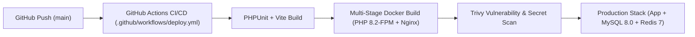

# Phase 06 — Design Review: Production Readiness, Containerization & CI/CD Go-Live

**Project**: C28 — Software & Cloud Engineering (`c28studios`)
**Phase**: `phase-06-production-readiness`
**Stage**: Stage A — Design Review (Approval Gate)
**Date**: 2026-11-13
**Status**: **AWAITING USER APPROVAL (HARD STOP)**

---

## 1. Objective & Scope

Phase 06 packages the **C28 — Software & Cloud Engineering** platform (`c28studios`) into a reproducible, hardened, production-grade deployment architecture that embodies the exact DevOps and DevSecOps engineering standards showcased on the C28 storefront.

### In-Scope Deliverables
1. **Containerization Architecture (`Dockerfile`, `.dockerignore`, `docker-compose.yml`, `docker/entrypoint.sh`)**:
   - Multi-stage `Dockerfile`:
     - **Stage 1 (`frontend-assets`)**: `node:20-alpine` compiling production Tailwind CSS v3.4 and Vanilla JS assets via `npm ci && npm run build`.
     - **Stage 2 (`vendor-deps`)**: `composer:2` installing deterministic production PHP dependencies (`composer install --no-dev --optimize-autoloader --no-interaction`).
     - **Stage 3 (`production-runtime`)**: `php:8.2-fpm-alpine` with `pdo_mysql`, `opcache`, `intl`, `zip`, `bcmath`, Nginx, and Supervisor running as a hardened non-root application user (`c28user`), plus an automated startup entrypoint (`docker/entrypoint.sh`) with `/up` healthcheck support.
   - `docker-compose.yml`: Full production/staging parity orchestrating the `app` container, `mysql:8.0` database with persistent volume and healthcheck, and `redis:7-alpine` cache/session/queue store.
2. **Nginx & Security Header Hardening (`docker/nginx/default.conf`, `docker/php/opcache.ini`)**:
   - Production Nginx server configuration with `gzip` compression, immutable `public/build/` asset caching (`Cache-Control: public, max-age=31536000, immutable`), hidden dotfile protection, PHP-FPM FastCGI tuning, and strict DevSecOps HTTP security headers (`X-Frame-Options: SAMEORIGIN`, `X-Content-Type-Options: nosniff`, `Referrer-Policy: strict-origin-when-cross-origin`, `Permissions-Policy`, and TLS 1.3 / `Strict-Transport-Security` readiness).
3. **Automated CI/CD & DevSecOps Pipeline (`.github/workflows/deploy.yml`)**:
   - GitHub Actions workflow executing on `push` and `pull_request` to `main`:
     - **Job 1 (`quality-and-tests`)**: PHP 8.2 setup, Composer install, Node 20 `npm ci && npm run build`, `php artisan config:clear`, and full PHPUnit verification (`php artisan test --ansi`).
     - **Job 2 (`devsecops-container-scan`)**: Builds the multi-stage Docker image (`c28studios:sha`) and runs **Aqua Security Trivy** (`aquasecurity/trivy-action`) scanning for `CRITICAL` and `HIGH` vulnerabilities and secret leaks.
     - **Job 3 (`production-deploy-gate`)**: Conditional deployment gate (`if: github.ref == 'refs/heads/main'`) ready for SSH/registry rollout once repository secrets are configured.
4. **Production Environment Template & Operational Runbook (`.env.production.example`, `README.md`)**:
   - Hardened `.env.production.example` (`APP_ENV=production`, `APP_DEBUG=false`, `LOG_LEVEL=warning`, `SESSION_DRIVER=redis`, `CACHE_STORE=redis`, `QUEUE_CONNECTION=redis`, `SESSION_SECURE_COOKIE=true`).
   - Automated `tests/Feature/ProductionReadinessTest.php` verifying the `/up` health endpoint, production configuration invariants, and presence/syntax of all DevOps/DevSecOps artifacts (`Dockerfile`, `docker-compose.yml`, `docker/nginx/default.conf`, `.github/workflows/deploy.yml`).

---

## 2. Stage 0 Discovery & Current State Audit

| Area | Current State (Post-Phase 05) | Phase 06 Target |
| :--- | :--- | :--- |
| Application & CMS | Phases 01–05 complete (`Service`, `Project`, `PricingTier`, `Post`, `Faq`, `SiteSetting`, `Inquiry` + `/admin` Filament v3 Control Plane + public storefront) | Preserve 100% of application behavior while adding production containerization, CI/CD, and security hardening |
| Containerization | Referenced in seeded code artifacts (`C28ContentSeeder`), not yet materialized at repository root | Create real, runnable `Dockerfile`, `.dockerignore`, `docker-compose.yml`, and `docker/` configs at repository root |
| CI/CD Pipeline | Referenced in seeded code artifacts, no `.github/workflows/` directory yet | Create real `.github/workflows/deploy.yml` running PHPUnit, Vite build, Docker build, and Trivy scan |
| Production Env Config | `.env.example` configured for local development | Add `.env.production.example` and update `README.md` with Docker & Herd operational runbooks |

---

## 3. Containerization & Runtime Architecture

### 3.1 Multi-Stage `Dockerfile` Design
1. **Stage 1 (`node:20-alpine` as `frontend`)**:
   - Copies `package.json`, `package-lock.json`, `vite.config.js`, `tailwind.config.js`, `postcss.config.js`, `resources/`.
   - Runs `npm ci && npm run build` to produce `public/build/manifest.json` and hashed CSS/JS bundles.
2. **Stage 2 (`php:8.2-fpm-alpine` as `production`)**:
   - Installs system libraries (`nginx`, `supervisor`, `curl`, `libzip-dev`, `icu-dev`, `oniguruma-dev`), PHP extensions (`pdo_mysql`, `bcmath`, `intl`, `zip`, `opcache`), and Composer.
   - Copies application source, installs production vendor packages (`composer install --no-dev --optimize-autoloader --no-interaction`), and copies compiled `public/build` from Stage 1.
   - Copies `docker/nginx/default.conf`, `docker/php/opcache.ini`, `docker/supervisor/supervisord.conf`, and `docker/entrypoint.sh`.
   - Sets ownership for `storage/` and `bootstrap/cache/` and configures `HEALTHCHECK` against `http://127.0.0.1:8080/up`.

---

## 4. Nginx & DevSecOps Security Header Specification

`docker/nginx/default.conf` will enforce:
- Listener on port `8080` (non-privileged container port mapped to host/reverse-proxy `80`/`443`).
- Security headers:
  - `X-Frame-Options "SAMEORIGIN" always;`
  - `X-Content-Type-Options "nosniff" always;`
  - `Referrer-Policy "strict-origin-when-cross-origin" always;`
  - `Permissions-Policy "camera=(), microphone=(), geolocation=()" always;`
- Static asset caching for `/build/` (`expires 1y; add_header Cache-Control "public, immutable";`).
- Denial of hidden files (`location ~ /\.(?!well-known).* { deny all; }`).

---

## 5. File-by-File Implementation Plan

| Action | File Path | Description |
| :--- | :--- | :--- |
| **CREATE** | `Dockerfile` | Multi-stage production Dockerfile (Node 20 asset build + PHP 8.2-FPM Alpine + Nginx + Supervisor) |
| **CREATE** | `.dockerignore` | Excludes `.git`, `node_modules`, `vendor`, `.env`, `storage/logs/*` from Docker build context |
| **CREATE** | `docker-compose.yml` | Orchestrates `app`, `mysql` (MySQL 8.0), and `redis` (Redis 7 Alpine) with healthchecks |
| **CREATE** | `docker/nginx/default.conf` | Hardened Nginx configuration with security headers, gzip, and FastCGI tuning |
| **CREATE** | `docker/php/opcache.ini` | Production PHP OPcache and memory/upload limits |
| **CREATE** | `docker/supervisor/supervisord.conf` | Manages `php-fpm` and `nginx` processes with stdout/stderr logging |
| **CREATE** | `docker/entrypoint.sh` | Runs `config:cache`, `route:cache`, `view:cache`, optional `migrate --force`, and starts Supervisor |
| **CREATE** | `.github/workflows/deploy.yml` | Automated CI/CD pipeline: PHPUnit tests, Vite build, Docker build, and Trivy security gate |
| **CREATE** | `.env.production.example` | Hardened production environment template |
| **MODIFY** | `README.md` | Documents full architecture, local Herd workflow, Docker deployment, and CI/CD runbook |
| **CREATE** | `tests/Feature/ProductionReadinessTest.php` | Automated tests verifying `/up` healthcheck and production infrastructure artifacts |

---

## 6. Verification Plan (Stage C)

1. `php artisan test --ansi` — Verify all test suites (`ExampleTest`, `FoundationTest`, `DomainSchemaTest`, `AdminCmsResourcesTest`, `PublicFrontendTest`, `LeadCaptureInquiryTest`, and `ProductionReadinessTest`) pass 100%.
2. `npm run build` — Verify production Vite assets build cleanly.
3. `php artisan route:list --ansi` — Verify `/up` healthcheck, public routes, inquiry route, and `/admin` routes.

---

## 7. Approval Gate (Stage A Hard Stop)

This Phase 06 Design Review is complete and awaits explicit user approval before any Phase 06 files are created.

